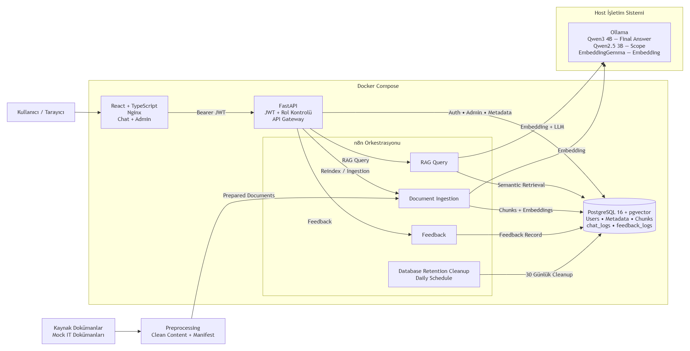

# İZELTAŞ IT Danışma Asistanı

Yerel LLM ve RAG tabanlı IT destek chatbot prototipi.

## Proje hakkında

İZELTAŞ IT Danışma Asistanı, kullanıcıların IT süreçleri ve destek soruları için yerel kaynaklara dayalı, kısa Türkçe yanıtlar üretir. Sistem, ilgili doküman bölümlerini RAG yaklaşımıyla bulur, yanıtı yerel Ollama modelleriyle oluşturur ve kullanılan kaynakları arayüzde gösterir.

Proje yazılım mühendisliği stajı kapsamında yerel geliştirme, test ve demonstrasyon amacıyla hazırlanmıştır. Gerçek şirket verileri yerine zenginleştirilmiş ve Türkçeleştirilmiş 12 kategorize mock IT destek dokümanı kullanılır; doküman işleme, retrieval ve model inference yerel ortamda gerçekleşir.

## Temel özellikler

- JWT tabanlı oturum açma ve kullanıcı/admin rolleri
- PostgreSQL + pgvector üzerinde RAG tabanlı benzerlik araması
- Kaynak bilgileriyle birlikte kısa Türkçe cevaplar
- Yararlı / yararlı değil geri bildirimi
- Özet metrikler ve inceleme kuyruğu içeren admin paneli
- Kullanıcı oluşturma, rol, durum ve silme yönetimi
- MD, TXT, PDF ve DOCX dokümanları listeleme, yükleme, güncelleme, indirme ve silme (maksimum upload boyutu 10 MiB)
- Tam doküman reindex'i ve bilinçli boş doküman seti desteği
- Backend, PostgreSQL, n8n ve Ollama için sistem durumu ekranı
- Staging tablosu, doğrulama ve advisory lock kullanan güvenli reindex akışı
- Yerel cevap, scope-classifier ve embedding modelleri
- Regresyon, retrieval normalizasyonu, kararlılık ve RAG güvenliği için değerlendirme altyapısı

## Mimari

```text
Tarayıcı
  → React + TypeScript frontend
  → FastAPI Gateway
      ├─→ PostgreSQL (kimlik, yönetim ve log verileri)
      └─→ n8n workflow'ları
            ├─→ PostgreSQL + pgvector
            └─→ Ollama
```

Frontend n8n webhook'larını doğrudan çağırmaz. Kullanıcı ve admin istekleri FastAPI üzerinden geçer; FastAPI'nin n8n istekleri `X-Internal-Webhook-Key` ile korunur.

Docker Compose PostgreSQL + pgvector, n8n, FastAPI backend ve Nginx üzerinden sunulan frontend'i çalıştırır. Ollama donanım erişimi için host bilgisayarda çalışır.

## Sistem Mimarisi

Projenin genel sistem mimarisi aşağıdaki diyagramda gösterilmektedir.



## Teknolojiler

| Katman | Teknoloji |
|---|---|
| Frontend | React, TypeScript, Vite, Nginx |
| Backend | FastAPI, SQLAlchemy, Pydantic, Uvicorn |
| Kimlik doğrulama | JWT, bcrypt |
| Workflow orkestrasyonu | n8n |
| Veritabanı | PostgreSQL 16, pgvector |
| Migration | Alembic |
| Yerel model runtime | Ollama |
| Ana cevap modeli | `qwen3:4b-instruct-2507-q4_K_M` |
| Scope classifier | `qwen2.5:3b` |
| Embedding modeli | `embeddinggemma:latest` |
| Dağıtım | Docker, Docker Compose |
| Doğrulama | pytest, ESLint, TypeScript/Vite build, Python değerlendirme scriptleri |

## Workflow'lar

Repo dört güncel n8n workflow exportu içerir:

| Dosya | Workflow ve görev |
|---|---|
| `rag-query-webhook-workflow.json` | **RAG Query Webhook Workflow:** soru sınıflandırma, retrieval, yanıt üretimi ve chat log akışı |
| `langchain-document-ingestion-workflow.json` | **LangChain Document Ingestion Workflow:** manifest tabanlı ingestion ve staging tabanlı reindex işlemi |
| `feedback-webhook-workflow.json` | **Feedback Webhook Workflow:** kullanıcı geri bildirimini chat kaydıyla ilişkilendirme |
| `database-retention-cleanup-workflow.json` | **Database Retention Cleanup:** 30 günden eski chat ve feedback logları için zamanlanmış yerel temizlik |

Exportlar [`n8n-workflows/`](n8n-workflows/) dizinindedir.

## Repo yapısı

```text
local-rag-it-assistant/
├─ backend/                         FastAPI uygulaması, Alembic ve testler
├─ data/
│  ├─ source-documents/           Mock kaynak dokümanlar
│  ├─ processed-documents/        İşlenmiş Markdown dosyaları
│  └─ documents.json              Ingestion manifesti
├─ database/                        Şema ve bakım SQL referansları
├─ docker/                          Compose ve ortam örneği
├─ docs/
│  ├─ deployment-guide/           Ayrıntılı yerel kurulum rehberi
│  └─ evaluation/                 Vakalar ve kaydedilmiş sonuçlar
├─ frontend/                        React + TypeScript uygulaması
├─ n8n-workflows/                   Dört workflow exportu
├─ scripts/                         Doküman ve değerlendirme araçları
└─ requirements-doc-processing.txt  Doküman işleme bağımlılıkları
```

## Kuruluma başlama

Tam yerel kurulum için Git, Docker Desktop, Docker Compose v2 ve Ollama gerekir.

Repoyu klonlayın:

```powershell
git clone <repository-url>
Set-Location local-rag-it-assistant
```

Gerekli modelleri host bilgisayarda indirin:

```powershell
ollama pull qwen3:4b-instruct-2507-q4_K_M
ollama pull qwen2.5:3b
ollama pull embeddinggemma:latest
```

Repo kökünden Docker ortam dosyasını oluşturun:

```powershell
Copy-Item docker/.env.example docker/.env
```

`docker/.env` içindeki placeholder parola ve secret değerlerini değiştirdikten sonra Compose yığını başlatın:

```powershell
Set-Location docker
docker compose up -d --build
```

n8n credential ve workflow importu, demo kullanıcıları, doküman hazırlama, ilk reindex ve smoke test adımları için [Yerel Kurulum Rehberi](docs/deployment-guide/README.md) izlenmelidir.

Kurulum rehberindeki komutlar Windows 10/11 ve PowerShell ile doğrulanmıştır. Docker tabanlı mimari macOS ve Linux üzerinde de çalışabilir; işletim sistemine özgü komutlar, dosya izinleri, Docker host erişimi ve Ollama bağlantısı için uyarlama gerekebilir.

Tam kullanımdan önce `docker/.env` içindeki gerekli secret değerleri değiştirilmeli, Ollama modelleri host üzerinde bulunmalı, n8n credential ve workflow importları yapılmalı, demo kullanıcıları oluşturulmalı ve ilk doküman reindex'i çalıştırılmalıdır.

Varsayılan servis adresleri:

| Servis | Adres |
|---|---|
| Frontend | `http://localhost:5173` |
| FastAPI | `http://127.0.0.1:8000` |
| Swagger UI | `http://127.0.0.1:8000/docs` |
| n8n | `http://localhost:5678` |
| Ollama | `http://localhost:11434` |

## Doğrulama ve değerlendirme

Backend testleri, `backend/` dizininde uygulama ve test bağımlılıkları kurulu bir Python ortamında çalıştırılır:

```powershell
pytest
```

Frontend statik kontrolleri repo kökünden çalıştırılabilir:

```powershell
npm.cmd --prefix frontend run lint
npm.cmd --prefix frontend run build
```

Güncel retrieval ayarları `topK = 5`, `SCORE_THRESHOLD = 0.54` ve `MAX_SOURCES = 3` değerlerini kullanır. Skor/distance değeri küçüldükçe eşleşme daha iyi kabul edilir.

Çalışan yerel sistemde 50 vakalı RAG regresyonunu başlatmak için:

```powershell
python scripts/run_rag_evaluation.py `
  --model qwen3-4b-instruct-2507-prompt-fallback `
  --cases docs/evaluation/cases/rag-regression-cases-mock-data.json `
  --repeat 1
```

Repository'de kayıtlı son final regresyon çalıştırması 50 vakanın 50'sinde başarılıdır. Ayrıntılı sonuçlar ve özet, `docs/evaluation/results/qwen3-4b-instruct-2507-prompt-fallback/` altındaki `results.csv` ve `summary.csv` dosyalarındadır.

Repo ayrıca retrieval normalizasyonu, tekrarlı kararlılık ve güvenlik vakaları ile kaydedilmiş CSV sonuçları içerir. Test kapsamı ve sonuç dosyaları için [Değerlendirme Dokümantasyonu](docs/evaluation/README.md) incelenebilir.

## Dokümantasyon

| Belge | Kapsam |
|---|---|
| [Yerel Kurulum Rehberi](docs/deployment-guide/README.md) | Docker, Ollama, n8n, migration, demo kullanıcıları, ilk reindex ve sorun giderme |
| [Değerlendirme Dokümantasyonu](docs/evaluation/README.md) | Değerlendirme vakaları ve kaydedilmiş sonuç yapısı |
| [Veritabanı şema referansı](database/schema.sql) | Alembic ile yönetilen şemanın okunabilir SQL karşılığı |

## Güvenlik ve gizlilik

- Repo gerçek şirket verisi değil, mock IT destek dokümanları içerir.
- LLM inference, embedding, doküman işleme ve veri saklama yerel ortamda gerçekleşir.
- Gerçek `.env` dosyaları ve secret değerleri repoya eklenmemelidir.
- FastAPI'nin dahili n8n webhook çağrıları `X-Internal-Webhook-Key` ile korunur; frontend n8n'i doğrudan çağırmaz.
- Demo hesapları üretim hesabı değildir ve varsayılan demo parolaları üretim benzeri ortamlarda kullanılmamalıdır.

## Prototip sınırları

- Yerel geliştirme, test ve staj demonstrasyonu için tasarlanmıştır; üretime hazır bir dağıtım değildir.
- Kurumsal SSO, TLS sonlandırma, yüksek erişilebilirlik, merkezi secret yönetimi ve otomatik yedekleme sağlamaz.
- Varsayılan portlar yalnızca yerel arayüze bağlanır.

## Kullanım notu

Bu repository, yazılım mühendisliği stajı kapsamında geliştirilen yerel bir prototipi belgelemek ve göstermek amacıyla hazırlanmıştır.
